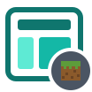

# Getting started

These pages take you from nothing to a working screen. A screen is written once against Strata's API and shown by an adapter, so first pick where yours will run:

| | Platform | Start with |
|---|---|---|
| { .strata-icon } | A Swing application or tool, or tests that render screens to images | [Installation](installation.md), then [Your first screen](first-screen.md) |
| { .strata-icon } | A Minecraft mod on NeoForge, Forge or Fabric, or a SpongeVanilla plugin | [Minecraft setup](../platforms/minecraft/index.md#setup), then [Your first screen](first-screen.md) and [Screens on Minecraft](../platforms/minecraft/screens.md) |
| { .strata-icon } | Another engine or toolkit | [Writing an adapter](../platforms/writing-an-adapter.md) |

1. [Installation](installation.md) covers what you need, how to depend on Strata from a Swing application or a Minecraft mod, and how to build it from source.
2. [Your first screen](first-screen.md) builds a small form step by step and shows it in a Swing window and in Minecraft.
3. [Core concepts](concepts.md) explains the ideas the rest of the documentation assumes: the component tree, the factory and hosts, the `Strata` services, UI units, layout passes, events, focus, overlays and themes.

If you learn best by reading code, the Strata-Gallery repository shows every control on a page of its own, written against the API only, with a log of the events each one fires. Run it with `./gradlew run`.
