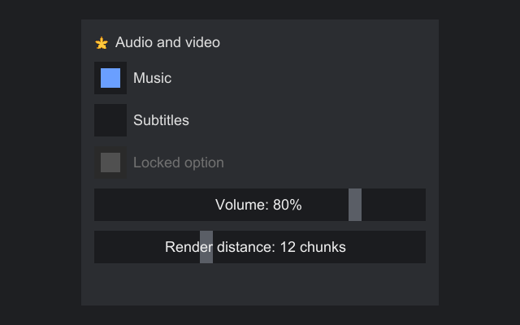

# Controls

Strata's built-in controls are interfaces in the subpackages of `org.inspirenxe.strata.api.control`, made by the factory: `display` (`Label`, `Image`, `ProgressBar`, `Separator`), `button` (`Button`, `CycleButton`, `CheckBox`, `RadioButton`, `RadioGroup`, `ToggleSwitch`), `field` (`TextBox`, `TextArea`, `Spinner`, `Slider`), `collection` (`ListView`, `ComboBox`, `TableView`, `TreeView`, `GridView`), `menu` (`Menu`, `MenuBar`), `pane` (`TabBar`, `Expander`, `SplitPane`) and `window` (`Window`, `MessageBox`). Each one has [events](events.md): a request (Pre) for each change the user can make, which a handler can cancel or rewrite, and a report (Post) for each change from any source. Each section below lists them in an Events table. Their theme keys are listed on each control below and in the [theme key reference](../reference/theme-keys.md). Scrolling is a container, [`ScrollPanel`](layout.md#scrollpanel), and popups, dialogs and tooltips are in [Overlays and tooltips](overlays.md).

## Attributes

Controls that do the same kind of thing share small interfaces called attributes, in `org.inspirenxe.strata.api.control.attribute`. A control has every attribute that fits it, so the same thing has the same name on every control, and code written against an attribute works for all of them.

| Attribute | Package | What it adds | Events | Controls |
|---|---|---|---|---|
| `HasText` | `text` | `text()`, `setText` | | `Button`, `CycleButton`, `CheckBox`, `RadioButton`, `ToggleSwitch`, `Label`, `ProgressBar`, and through `TextInput` the text fields |
| `Titled` | `text` | `title()`, `setTitle` | | `Window`, `Expander` |
| `TextInput` | `text` | the caret, the selection, `setMaxLength`, `setReadOnly`, `setTextPadding` | `EDIT`, `EDITED` | `TextBox`, `TextArea` |
| `Toggle` | `value` | `isSelected()`, `setSelected`, `toggle()` | `TOGGLE`, `TOGGLED` | `CheckBox`, `ToggleSwitch`, `RadioButton` |
| `Ranged` | `value` | `value()`, `setValue`, `min()`, `max()`, `setRange` | `CHANGE`, `CHANGED` | `Slider`, `Spinner`, `ProgressBar` |
| `Stepped` | `value` | `Ranged` plus `step()`, `setStep` | | `Slider`, `Spinner` |
| `ItemSource` | `item` | `items()`, `setItems`, `refresh()`, `setKeyFunction` | | `ListView`, `TableView`, `TreeView`, `ComboBox`, `GridView`, `CycleButton` |
| `CellSource` | `item` | `setCellFactory` | | `ListView`, `TreeView`, `GridView` |
| `SingleSelection` | `item` | `selectedIndex()`, `selected()`, `select(index)`, `selectItem(item)`, `clearSelection()` | `SELECT`, `SELECTED` | the collections, `CycleButton`, `TabBar`, `MenuBar`, `RadioGroup` |
| `Activatable` | `item` | `setActivateOnClick` | `ACTIVATE`, `ACTIVATED` | `ListView`, `TableView`, `TreeView`, `GridView` |
| `RowView` | `item` | row height and spacing, the placeholder, scrolling, `setDeselectable` | | `ListView`, `TableView`, `TreeView` |
| `Closable` | `popup` | `close()` | `CLOSE`, `CLOSED` | `Window`, `Overlay`, and through `Openable` the others |
| `Openable` | `popup` | `Closable` plus `isOpen()` | `OPEN`, `OPENED` | `ComboBox`, `Menu` |

An attribute owns its events, so `Toggle.TOGGLED` fires for a check box, a switch and a radio button alike, and one handler on a container hears every control inside it that has the attribute:

```java
// Save the settings page whenever any check box, switch or radio button on it changes
settings.onEvent(Toggle.TOGGLED, event -> save());

// Refresh the buttons whenever any list, table, tree, combo box or grid in the form changes selection
form.onEvent(SingleSelection.SELECTED, event -> updateButtons());
```

The event's `control()` is typed as the attribute, such as `Toggle<?>`, and `target()` is the component that fired it. An event fires only where it means something: a progress bar has no user input, so it reports `Ranged.CHANGED` but never asks with `Ranged.CHANGE`. Each control's section below says which events it fires and when. Events that only one control has, such as `Button.PRESSED` or `TableView.SORTED`, stay constants on that control.

## Label

Text the user reads but does not edit.

```java
Label title = factory.label("Settings").setStyle(TextStyle.DEFAULT.withBold(true));
Label help = factory.label(longText).setWrap(true);
help.setAlignment(HorizontalAlignment.STRETCH, VerticalAlignment.TOP);
```

| Method | Default | Notes |
|---|---|---|
| `setText(text)` | | `\n` starts a new line. A new layout runs if the text changed. |
| `setWrap(boolean)` | off | Also break between words to fit the width offered. See [Wrapping text](layout.md#wrapping-text). |
| `setStyle(TextStyle)` | `null` | Overrides the theme's `label.text` for this label. `null` goes back to the theme. |
| `setTextAlignment(HorizontalAlignment)` | `LEFT` | How each line sits within the label's width. It only shows when the label is wider than its text, for example when stretched. `STRETCH` acts as `LEFT`. |
| `setSpans(List<TextSpan>)` | none | Text made of runs that each keep their own style, such as a white name followed by a gray count. `text()` returns them joined, and `setText` goes back to plain text. |
| `setTextScale(float)` | 1 | Draws and measures the text larger or smaller, such as 0.8 for small print. Not greater than 0 throws. |
| `setOverflow(TextOverflow)` | `VISIBLE` | `ELLIPSIS` cuts a line that does not fit the bounds and ends it with `...`, and the label asks for no more width than it is offered. |

With wrapping on, a single word wider than a whole line is broken between characters, and spans wrap the same way, each piece keeping its run's style. The desired size is the widest line by the number of lines times the line height, all times the text scale.

```java
Label price = factory.label("")
        .setSpans(List.of(new TextSpan("125.50", gold), new TextSpan("/ea", gray)))
        .setTextScale(0.8f);
Label name = factory.label(item.name()).setOverflow(TextOverflow.ELLIPSIS);
name.setAlignment(HorizontalAlignment.STRETCH, VerticalAlignment.MIDDLE);
```

A label is not focusable and has no default behavior for input, so clicks and keys pass through to its ancestors. That makes labels handy click targets for a container-level handler; see [Handling events on a container](events.md#handling-events-on-a-container).

`style()` returns the style the label draws with: the one you set, or the theme's.

## Image

A sprite drawn at a size you choose, such as an icon or a picture.

```java
--8<-- "controls/ControlExamples.java:image"
```

| Method | Default | Notes |
|---|---|---|
| `setSprite(SpriteId)` | | The sprite, looked up as described in [Sprites](theming.md#sprites) |
| `setImageSize(w, h)` | 16 by 16 | The size in UI units. It is the desired size and the aspect ratio `FIT` keeps. Negative or infinite sizes throw. |
| `setScaling(Scaling)` | `STRETCH` | `STRETCH` covers the bounds; `FIT` draws as large as fits with the image size's aspect ratio, centered |
| `setTint(argb)` | `0xFFFFFFFF` | Multiplied with the sprite. Lower alpha fades it. |
| `setVisual(Visual)` | | Shows an engine visual instead of a sprite, and takes its natural size |

Strata cannot ask the engine how big an image file is, so set the image size yourself, usually to the size you want it drawn at. A missing sprite draws the engine's placeholder. An image reads no theme keys, is not focusable and has no input behavior, so clicks pass through to its ancestors. A disabled image looks the same as an enabled one; change its tint to show it.

### Engine visuals

A `Visual` is something only the engine can draw, such as a game's item icon. The API never names the engine's type: the adapter makes the visual from the engine object, and Strata hands it back to the adapter's canvas to draw. `factory.image(visual)` shows one at its natural size.

```java
// On Swing, any image
Image icon = factory.image(SwingVisuals.image(bufferedImage));
```

A canvas draws a placeholder for a visual it did not make. Each adapter documents the visuals it makes.

## Button

A push button with a text caption, an icon, or both.

```java
Button save = factory.button("Save").onEvent(Button.PRESSED, event -> this.save());
```

| Method | Notes |
|---|---|
| `setText(text)` | One line. A new layout runs. |
| `press()` | Presses it from code: fires `PRESSED` but no `PRESS` request. Does nothing while disabled. |
| `setTextPadding(Insets)` | Space between the caption and the edges. 8 left and right, 5 top and bottom by default; 2 on every side for an icon with no caption; none for a link. |
| `setIcon(SpriteId)`, `setIcon(Visual)` | Shows an icon before the caption. A visual is drawn at its natural size. |
| `setIconSize(width, height)` | The size the icon is drawn at, 16 by 16 by default. Strata cannot ask an engine for a sprite's size, so the caller gives it. |
| `clearIcon()` | Removes the icon. |
| `setLink(boolean)` | Makes the button a link. See below. |

A button presses on a left click, or on a press of Enter, keypad Enter or Space while it has focus. Held keys that repeat do not press it again. It consumes those inputs. A disabled button does neither and draws its disabled face.

It is focusable and tabbable, shows the hand cursor, and has a minimum size of 20 by 20. Its desired size is the caption plus the text padding. The caption is centered in whatever size the button ends up.

| Face | When |
|---|---|
| `button.normal` | Idle |
| `button.hovered` | Hovered or focused |
| `button.pressed` | Pressed with the pointer still over it |
| `button.disabled` | Disabled |
| `button.focus` (optional) | A one-unit ring drawn inside the edge while focused |

| Event | Kind | Fires |
|---|---|---|
| `Button.PRESS` | Pre | When the user presses it. Cancel to refuse the press. |
| `Button.PRESSED` | Post | After every press, including `press()` |

To react to other mouse buttons, such as a right click, handle `CLICK` yourself; see [Clicks](events.md#clicks).

### Icons

```java
Button refresh = factory.button("Refresh").setIcon(SpriteId.of("mymod", "refresh"));
Button settings = factory.button().setIcon(icon);
```

The icon is drawn 4 units before the caption, and the two are centered together as one block. A button with an icon and no caption is meant to be square: it pads by 2 units on every side, so a 16 by 16 icon gives 20 by 20. A disabled button draws its icon in half-bright gray. `setIcon` with a sprite keeps the current icon size, and with a visual takes the visual's size.

### Links

```java
Button terms = factory.button("Terms of sale").setLink(true).onEvent(Button.PRESSED, event -> this.openTerms());
```

A link has no frame. It draws only its caption, and the caption underlines while the link is hovered or focused. It has no padding and no minimum size, so it sits in a line of other text. It presses, focuses and fires events exactly like a button. `setLink(false)` brings the frame and the 20 by 20 minimum size back.

| Key | Used for |
|---|---|
| `button.link.text` (optional) | The caption. Falls back to `button.text`. |
| `button.link.text.hovered` (optional) | The caption while hovered or focused. Falls back to `button.link.text` underlined. |
| `button.link.text.disabled` (optional) | The caption when disabled. Falls back to `button.text.disabled`. |

A link reads none of the face keys and no focus ring.

## CycleButton

A button that steps through a list of values, one on each click, and shows the current one after its label, as in `Difficulty: Hard`.

```java
CycleButton<Difficulty> difficulty = factory.<Difficulty>cycleButton("Difficulty")
        .setItems(List.of(Difficulty.values()))
        .onEvent(SingleSelection.SELECTED, event -> this.apply());
```

| Method | Default | Notes |
|---|---|---|
| `setText(label)` | empty | The text before the value (`HasText`). With no label only the value shows, and with no value only the label. |
| `setValueLabelFunction(function)` | `String::valueOf` | Turns a value into its text. |
| `setItems(list)` | none | The values (`ItemSource`). The selection stays on the item with the same key, or moves to the first item. |
| `select(index)`, `selectItem(item)` | the first item | Chooses a value from code (`SingleSelection`). |
| `cycle(steps)` | | Moves the selection from code, wrapping at the ends. One step forward from nothing selects the first item. |

A left click, or Enter or Space while focused, selects the next value, and the first one after the last. A right click, or Shift with any of those, selects the previous one. A disabled button, or one with fewer than two values, ignores them. The button asks for the label plus its widest value, so cycling never changes its size, and it is focusable, tabbable and at least 20 by 20 units. It draws with the `button.*` keys of [`Button`](#button).

| Event | Kind | Fires |
|---|---|---|
| `SingleSelection.SELECT` | Pre | When the user steps to another value, with the index about to be selected. Cancel to keep the value, or set another index (-1 clears). |
| `SingleSelection.SELECTED` | Post | After the selection changed from any source, with the index and the previous index |

## CheckBox

A box that is checked or not, with a caption to its right.

```java
--8<-- "controls/ControlExamples.java:checkbox"
```

| Method | Default | Notes |
|---|---|---|
| `setText(text)` | | One line. May be empty for a box alone. |
| `setSelected(boolean)` | unchecked | Fires `TOGGLED` if the state changed. Works while disabled, so code can keep a disabled box in step with its setting. |
| `toggle()` | | Flips it from code: fires `TOGGLED` but no `TOGGLE` request. Does nothing while disabled. |
| `setBoxSize(size)` | line height plus 8 | The square box's size. `Float.NaN` goes back to the default, which is 17 with a 9-unit line height. |

A left click anywhere on the check box, caption included, toggles it, and so does a press of Enter, keypad Enter or Space while it has focus. It consumes those inputs. It is focusable and tabbable and shows the hand cursor. The caption sits 4 units right of the box, both centered vertically.

| Face | When |
|---|---|
| `checkbox.normal`, `checkbox.checked` | Idle |
| `checkbox.hovered`, `checkbox.checked.hovered` | Hovered or focused |
| `checkbox.disabled`, `checkbox.checked.disabled` (optional) | Disabled. Fall back to the idle faces. |
| `checkbox.mark`, `checkbox.mark.disabled` (optional) | Drawn over a checked box, inset by a fifth of its size |
| `checkbox.focus` (optional) | A one-unit ring inside the box's edge while focused |

Themes built from images can draw the check mark into the checked faces and leave `checkbox.mark` out. Themes built from colors use `checkbox.mark`.

| Event | Kind | Fires |
|---|---|---|
| `Toggle.TOGGLE` | Pre | When the user flips it, with the state about to be taken. Cancel to refuse, or set another state. |
| `Toggle.TOGGLED` | Post | After every change, with the new and previous state |

## Slider

A horizontal slider that picks a number from a range.

```java
--8<-- "controls/ControlExamples.java:slider"
```

| Method | Default | Notes |
|---|---|---|
| `setRange(min, max)` | 0 to 1 | Bounds must be finite with `max` above `min`. The value is clamped into the new range. |
| `setStep(step)` | 0, continuous | Values snap to `min + k * step`. The maximum is always reachable, even off that grid. |
| `setValue(value)` | 0 | Clamped and snapped. NaN throws. Works while disabled. |
| `setLabel(DoubleFunction<String>)` | none | Text drawn centered over the track, recomputed when the value changes. Text wider than the slider is cut off. |
| `keyStep()` | | The step, or a hundredth of the range without one |

| Event | Kind | Fires |
|---|---|---|
| `Ranged.CHANGE` | Pre | When a press, a drag move or a key would change the value, with the new value already clamped and snapped. Cancel to keep the old value, or set another, which is clamped and snapped again. |
| `Ranged.CHANGED` | Post | After every change, including each drag move and changes from `setValue`, `setRange` and `setStep` |

Both fire only when the value actually changes, so setting the same value twice, or a value that clamps or snaps to the current one, fires nothing.

Whole numbers come from a step of 1:

```java
--8<-- "controls/ControlExamples.java:integers"
```

Input:

- A left press anywhere on the slider moves the thumb's center to the pointer. Dragging then follows the pointer, even outside the slider, once it has moved past the 4-unit drag threshold.
- While focused, Left and Down lower the value by the key step and Right and Up raise it. Page Down and Page Up move ten key steps, and Home and End go to the ends. Held keys repeat.
- Scrolling is ignored, so a scroll over a slider reaches its ancestors and a scrolling panel still scrolls.

It is focusable and tabbable, shows the hand cursor, and wants 150 by 20 units. Stretch it or set a width to change its length. The thumb is 8 units wide and as tall as the slider.

| Key | Required | Used for |
|---|---|---|
| `slider.track` | yes | The track: the whole bounds |
| `slider.track.focused` | no | The track while focused. Falls back to `slider.track`. |
| `slider.track.disabled` | no | The track when disabled. Falls back to `slider.track`. |
| `slider.thumb` | yes | The thumb |
| `slider.thumb.hovered` | yes | The thumb while the slider is hovered, focused or pressed |
| `slider.thumb.disabled` | no | Falls back to `slider.thumb` |
| `slider.text`, `slider.text.disabled` | no | The label |

There is no vertical slider yet.

## The controls together



## TextBox

A single-line text field ported from Wintergreen's.

```java
TextBox name = factory.textBox()
        .setMaxLength(32)
        .onEvent(TextInput.EDITED, event -> preview.setText("Hello, " + event.value()));
name.setAlignment(HorizontalAlignment.STRETCH, VerticalAlignment.TOP);
```

### Settings

| Method | Default | Notes |
|---|---|---|
| `setText(text)` | empty | Removes line breaks, cuts to the length limit and puts the caret at the end. Fires `EDITED` if the text changed, but no `EDIT` request. |
| `setMaxLength(n)` | `Integer.MAX_VALUE` | Counted in code points. Longer text is cut at once, which fires `EDITED`. Negative throws. |
| `setPassword(boolean)` | off | Draws every code point as the mask character and disables copy and cut. `text()` still returns the real text. |
| `setMaskCodePoint(cp)` | `'*'` | The mask character |
| `setTextPadding(Insets)` | 4 left and right, 5 top and bottom | Space between the text and the edges |
| `setReadOnly(boolean)` | off | The box still focuses, selects and copies, but does not edit, and shows no caret. Its text uses `textbox.text.readonly`. |
| `setSelectAllOnFocus(boolean)` | off | Gaining focus selects everything, so typing replaces it. |

### Reading and selecting

| Method | Returns |
|---|---|
| `text()` | The text, never null |
| `caret()` | The caret, a char index from 0 to `text().length()` |
| `selectionStart()`, `selectionEnd()` | The selected range. Equal when nothing is selected. |
| `selectedText()` | The selected text, or empty |
| `select(anchor, caret)` | Selects a range. The anchor stays put and the caret is the moving end, as after Shift+arrow. Out-of-range indexes are clamped. |
| `selectAll()` | Selects everything, caret at the end |

Indexes count UTF-16 chars, like `String` indexes, but never fall inside a surrogate pair: editing always works on whole code points, so an emoji is deleted in one go. An index inside a pair given to `select` moves to the pair's start.

### Mouse

- A click puts the caret at the nearest character boundary. Shift+click extends the selection to it.
- A drag selects by character. A drag that starts with a double click selects whole words.
- A double click selects the word, or the run of spaces, under the pointer. Double-clicking the first letter of a word selects that word.
- A triple click selects everything.

### Keyboard

| Keys | Action |
|---|---|
| Left, Right | Move one code point. With a selection and no Shift, collapse it to its start or end. |
| Home, End | Move to the start or end |
| Ctrl+Left, Ctrl+Right | Move by word |
| Backspace, Delete | Delete the selection, or one code point |
| Ctrl+Backspace, Ctrl+Delete | Delete the selection, or one word |
| Shift with any movement | Extend the selection |
| Ctrl+A | Select all |
| Ctrl+C, Ctrl+X | Copy, cut. Nothing happens in password mode. |
| Ctrl+V | Paste. Line breaks in the pasted text are removed. |
| Typing | Replaces the selection. Text past the length limit is dropped. |

Shortcuts need Control held without Alt, so AltGr combinations, which many layouts report as Control plus Alt, type their characters instead of triggering shortcuts. On macOS, see the [platform note on Command](../platforms/differences.md#modifier-keys).

### Focus and the engine

The box is focusable and tabbable and shows the text cursor. Focus by Tab or `requestFocus()` puts the caret at the end; focus by a click puts it at the click. While focused, it:

- asks the engine for text input, which some engines need before they send any characters;
- consumes every key press that types a character (any printable key without Control or Alt), so engine shortcuts on those keys do not fire while you type;
- consumes the editing keys and shortcuts in the table above;
- does not consume Tab, Escape, Up, Down, Page Up or Page Down. Tab moves focus and Escape reaches the engine, which may close the screen. Enter is consumed only when a `SUBMIT` or `SUBMITTED` handler is on the box's path; otherwise it bubbles to ancestors.

A disabled box ignores input.

### Drawing

The caret is one unit wide and blinks every half second on the host's clock. It shows again after each edit or move. When the text is wider than the box, it scrolls sideways to keep the caret in view.

| Key | Required | Used for |
|---|---|---|
| `textbox.normal` | yes | Background when not focused |
| `textbox.focused` | yes | Background when focused |
| `textbox.disabled` | yes | Background when disabled |
| `textbox.text` | no | Text style. Falls back to the default text style. |
| `textbox.text.disabled` | no | Text when disabled. Falls back to `textbox.text`. |
| `textbox.text.readonly` | no | Text when read-only. Falls back to `textbox.text.disabled`. |
| `textbox.selection` | no | Behind selected text. Falls back to translucent blue. |
| `textbox.caret` | no | The caret. Falls back to light gray. |

### Events

| Event | Kind | Fires |
|---|---|---|
| `TextInput.EDIT` | Pre | When the user's typing, deleting, cutting or pasting would change the text, with the whole text it would produce. Cancel to reject the edit, or set another text, which is cleaned of line breaks and cut to the length limit. |
| `TextInput.EDITED` | Post | After every change of the text, with the new and previous text, including `setText` and `setMaxLength` cutting |
| `TextBox.SUBMIT` | Pre | When the user presses Enter or keypad Enter. Cancel to ignore it. |
| `TextBox.SUBMITTED` | Post | After a submit nobody canceled, with the text |

### Size

The desired size is 120 units wide and one line plus the text padding tall, with a minimum of 20 by 20. Stretch it or set a width to make it wider.

### Common recipes

Submit on Enter:

```java
--8<-- "events/EventExamples.java:submit"
```

Accept only a whole number up to a limit:

```java
amount.onEvent(TextInput.EDIT, event -> {
    String digits = event.value().replaceAll("[^0-9]", "");
    event.setValue(digits.isEmpty() ? "" : Long.toString(Math.min(Long.parseLong(digits), max)));
});
```

React to each change: `TextInput.EDITED`. React only when the user leaves the field: handle `FOCUS_LOST`.

## ListView

A scrolling list of items with single selection. Each row is built by a cell factory, and only the rows in view exist, so a list of thousands of items costs no more than a screenful.

```java
ListView<Listing> listings = factory.<Listing>listView(listing -> factory.label(listing.name()))
        .setRowHeight(24)
        .setKeyFunction(Listing::record)
        .setPlaceholder("No results found.")
        .onEvent(SingleSelection.SELECTED, event -> updateButtons())
        .onEvent(Activatable.ACTIVATED, event -> buy(listings.items().get(event.value()), 1));
listings.setItems(fromServer);
```

| Method | Default | Notes |
|---|---|---|
| `setItems(list)` | empty | Rebuilds the rows in view. The selection stays on the item with the same key, or clears. |
| `setKeyFunction(f)` | the item itself | How items are told apart when `setItems` keeps the selection, such as a record id from the server |
| `setRowHeight(h)`, `setRowSpacing(s)` | 20, 0 | Every row has the same height |
| `select(index)`, `selectItem(item)` | nothing selected | Selecting scrolls the row into view. -1 clears. |
| `setDeselectable(boolean)` | off | A press on the selected row deselects it |
| `setActivateOnClick(boolean)` | off | A single click activates, as in a drop-down, instead of a double click |
| `setPlaceholder(text)` | none | Shown in the middle while there are no items |
| `refresh()` | | Rebuilds the rows in view from the same items |
| `setScrollY(y)`, `scrollToIndex(i)` | | Scroll by code |

A press on a row selects it, unless something in the cell consumed the press. A double click or Enter activates the selected item. While focused, Up, Down, Page Up, Page Down, Home and End move the selection. The wheel scrolls one row per notch, and the scroll bar works as in a [`ScrollPanel`](layout.md#scrollpanel). Rows sit inside the list's border widths, so a bordered list keeps its rows off the border.

Build each cell fresh from its item, and keep nothing in it that must survive scrolling: a row that scrolls out is dropped and rebuilt when it comes back.

| Key | Required | Used for |
|---|---|---|
| `list.row.selected` | yes | The selected row |
| `list.row` | no | Every other row. Nothing if missing. |
| `list.row.hovered` | no | The row under the pointer. Falls back to `list.row`. |
| `list.placeholder` | no | Placeholder text style |
| `scroll.*` | | The scroll bar, as for `ScrollPanel` |

| Event | Kind | Fires |
|---|---|---|
| `SingleSelection.SELECT` | Pre | When a press or a key would change the selection, with the row index, or -1 to clear. Cancel to keep the selection, or set another row. |
| `SingleSelection.SELECTED` | Post | After every change of the selected row, including `select`, `selectItem` and `setItems` |
| `Activatable.ACTIVATE` | Pre | When the user activates a row: a double press, Enter, or a click with `setActivateOnClick` |
| `Activatable.ACTIVATED` | Post | After an activation nobody canceled, with the row index |

## ComboBox

A drop-down that shows the selected option and opens a list of every option.

```java
ComboBox<SortType> sort = factory.<SortType>comboBox(SortType::label)
        .setItems(List.of(SortType.values()))
        .onEvent(SingleSelection.SELECTED, event -> search());
```

A click opens the list as a [popup](overlays.md#popups), at least as wide as the box; a click on an option selects it. While closed and focused, Up, Down, Home and End change the selection, and Enter, Space or Alt+Down open it. While open, Up and Down move the highlight, Enter or Space picks it, and Escape closes without changing anything. `setMaxVisibleOptions(n)` (8 by default) caps how many rows show before the list scrolls. `setItems` keeps the selection on the option with the same key (`setKeyFunction`, the option itself by default), or selects the first option. `clearSelection()` leaves nothing selected, and the box then shows no text.

| Key | Required | Used for |
|---|---|---|
| `combobox.normal` | yes | The box |
| `combobox.popup` | yes | Behind the open list |
| `combobox.hovered` | no | The box while hovered, focused or open. Falls back to `combobox.normal`. |
| `combobox.disabled` | no | The box when disabled. Falls back to `combobox.normal`. |
| `combobox.text`, `combobox.text.disabled` | no | The option text |

| Event | Kind | Fires |
|---|---|---|
| `Openable.OPEN` | Pre | When the user opens the list. A handler can change the options first, or cancel. |
| `Openable.OPENED` | Post | After the list opened, including `open()` |
| `SingleSelection.SELECT` | Pre | When the user picks an option, or Up, Down, Home or End on the closed box would change it, with the option index |
| `SingleSelection.SELECTED` | Post | After every change of the selected index, including `select`, `selectItem`, `clearSelection` and `setItems` |
| `Closable.CLOSED` | Post | Each time the list closes, however it closed. The box never fires `Closable.CLOSE`. |

## Window

A framed panel with a title bar and a close button. Children are laid out below the bar as in an `AnchorPanel`, inside 3 units of padding.

```java
Window window = factory.window("Exchange").add(content);
window.setSize(600, 370);
window.onClose(handle::close);
```

Dragging the title bar moves the window, through its [offset](layout.md#offset), kept inside the slot its parent gives it (`setMovable(false)` stops that). The close button and an Escape the window acts on fire `Closable.CLOSE`, which a handler can cancel, then call `close()`, which fires `Closable.CLOSED` and closes the overlay showing the window. A window that is a screen's content does not close itself: close the screen from a `CLOSED` handler. With no `CLOSE` or `CLOSED` handler on its path, and outside an overlay, it leaves Escape to the engine. `setClosable(false)` hides the button and ignores Escape. A new window is centered in its slot.

| Key | Required | Used for |
|---|---|---|
| `window.background` | yes | The whole window |
| `window.title` | no | The title bar. Nothing if missing. |
| `window.title.text` | no | The title |
| `window.close`, `window.close.hovered` | no | The close button's `x` |

| Event | Kind | Fires |
|---|---|---|
| `Closable.CLOSE` | Pre | When the close button or an Escape the window acts on asks to close it. Cancel to keep it open. |
| `Closable.CLOSED` | Post | Each time it closes, including `close()` |

## MessageBox

A window with a message and a row of buttons, opened as a [dialog](overlays.md#dialogs).

```java
--8<-- "overlays/OverlayExamples.java:message-box"
```

The buttons come in sets: `OK`, `OK_CANCEL`, `YES_NO`, `YES_NO_CANCEL` and `CLOSE`. The first one is focused when the dialog opens. A button, the close button or Escape asks with `MessageBox.ANSWER`, which a handler can cancel to keep the box open or rewrite, then reports the `Result` once with `MessageBox.ANSWERED` and closes the dialog; the close button and Escape answer No or Cancel. `setButtonText(result, caption)` translates a caption, and `window()` gives the window for its title or size. The message wraps at 280 units.

| Event | Kind | Fires |
|---|---|---|
| `MessageBox.ANSWER` | Pre | When a button, the close button or Escape answers, with the `Result`. Cancel to keep the box open, or set another result. |
| `MessageBox.ANSWERED` | Post | Once, when the box answers, before its overlay closes |

## TabBar

A row of tabs, one of them selected. It only picks a tab; show the matching content from `SingleSelection.SELECTED`. Each tab is a `Tab`, made with `factory.tab(text)` or by the `addTab(text)` shorthand, which holds its text, whether it is enabled, and its tooltip. `tabs()` lists them, `addTab(tab)`, `addTab(index, tab)` and `removeTab(tab)` change them, `selected()` is the selected `Tab` and `selectItem(tab)` selects one.

```java
Tab sell = factory.tab("Sell")
        .setEnabled(false)
        .setTooltip(Tooltip.text("There are no items for sale."));
TabBar sides = factory.tabBar()
        .addTab("Buy")
        .addTab(sell)
        .onEvent(SingleSelection.SELECTED, event -> showSide(event.value()));
```

A change to a tab shows in its bar at once, and a tab belongs to one bar at a time.

Tabs share the width equally. A click selects an enabled tab, and Left and Right do while the bar has focus. A disabled tab still shows its tooltip.

| Key | Required | Used for |
|---|---|---|
| `tab.normal`, `tab.selected` | yes | Unselected and selected tabs |
| `tab.hovered`, `tab.disabled` | no | Fall back to `tab.normal` |
| `tab.text`, `tab.text.selected`, `tab.text.disabled` | no | Tab text |

| Event | Kind | Fires |
|---|---|---|
| `SingleSelection.SELECT` | Pre | When a click or Left and Right would select another tab, with its index. A rewritten index that is disabled or out of range is ignored. |
| `SingleSelection.SELECTED` | Post | After another tab was selected, including `select` |

## ProgressBar

A bar filled from the left to show how far a value is through its range, with an optional caption, such as how much of a quota is used.

```java
ProgressBar quota = factory.progressBar()
        .setRange(0, limit)
        .setValue(used)
        .setText(used + "/" + limit);
```

The range is 0 to 1 by default, so the value is the fraction filled. `setValue` clamps to the range and NaN throws. `setRange` needs `max` above `min` and clamps the value into it. Every change of the value reports `Ranged.CHANGED`. Keys: `progress.track` and `progress.fill` (paints, required) and `progress.text` (text style, optional).

## Separator

A thin line across or down a panel: `factory.separator(Orientation.HORIZONTAL)` stretches across its slot and is one unit tall, `setThickness` changes that. Key: `separator` (paint, required).

## RadioButton and RadioGroup

A set of choices of which at most one is picked. The group is not a component: it makes the buttons, and you place them in any layout.

```java
RadioGroup<Difficulty> difficulty = factory.radioGroup();
column.add(difficulty.add("Easy", Difficulty.EASY))
        .add(difficulty.add("Hard", Difficulty.HARD));
difficulty.selectItem(settings.difficulty())
        .onEvent(SingleSelection.SELECTED, event -> settings.setDifficulty(difficulty.selected().orElseThrow()));
```

Each button stands for a value, and `group.selected()` returns the value of the selected one. A new group has nothing selected. A click, Enter or Space selects a button. Up and Left move the selection and focus to the previous usable button in the group, Down and Right to the next, wrapping at the ends and skipping disabled, hidden and detached buttons. `button.setSelected(true)`, `group.select(index)` and `group.selectItem(value)` work while disabled too; `selectItem` with a value no button stands for clears the selection. A button measures and draws like a [`CheckBox`](#checkbox), with the mark inset by three tenths of the box.

| Key | Required | Used for |
|---|---|---|
| `radio.normal`, `radio.hovered` | yes | The box when not selected, plain and hovered or focused |
| `radio.selected`, `radio.selected.hovered` | yes | The box when selected |
| `radio.disabled`, `radio.selected.disabled` | no | Disabled boxes. Fall back to `radio.normal` and `radio.selected`. |
| `radio.mark`, `radio.mark.disabled` | no | Drawn over a selected box |
| `radio.focus` | no | A one-unit ring while focused |
| `radio.text`, `radio.text.disabled` | no | The caption |

| Event | Kind | Fires |
|---|---|---|
| `Toggle.TOGGLE` | Pre | On the button about to be selected, by a click, Enter, Space or an arrow key, with the value true. Cancel to keep the selection and focus as they are. |
| `Toggle.TOGGLED` | Post | On each button whose state changed, the one deselected first, from any source |
| `SingleSelection.SELECTED` | Post | On the group, after the selected button changed from any source, with its index in `buttons()` or -1. Register it on the group: `group.onEvent(SingleSelection.SELECTED, ...)`. |

## ToggleSwitch

An on and off switch with a sliding knob, for settings that take effect at once.

```java
ToggleSwitch pvp = factory.toggleSwitch("PvP").setSelected(settings.pvp())
        .onEvent(Toggle.TOGGLED, event -> settings.setPvp(event.value()));
```

A click, Enter or Space flips it. `setSelected` works while disabled; `toggle()` does not. The track is the caption's line height plus 4 tall and twice that wide, the knob a square 2 units in from its edges, and the caption 4 units to its right.

| Key | Required | Used for |
|---|---|---|
| `toggle.track`, `toggle.track.on` | yes | The track when off and on |
| `toggle.knob` | yes | The knob |
| `toggle.track.disabled` | no | Falls back to `toggle.track` |
| `toggle.knob.hovered`, `toggle.knob.disabled` | no | Fall back to `toggle.knob` |
| `toggle.focus` | no | A one-unit ring inside the track while focused |
| `toggle.text`, `toggle.text.disabled` | no | The caption |

| Event | Kind | Fires |
|---|---|---|
| `Toggle.TOGGLE` | Pre | When the user flips it, with the state about to be taken |
| `Toggle.TOGGLED` | Post | After every change, including `setSelected` and `toggle()` |

## Spinner

A number in a field with step buttons, such as a quantity.

```java
Spinner amount = factory.spinner().setRange(1, 64).setValue(1)
        .onEvent(Ranged.CHANGED, event -> this.amount = event.value().intValue());
Spinner price = factory.spinner().setRange(0, 10_000).setDecimals(2).setStep(0.25);
```

| Method | Default | Notes |
|---|---|---|
| `setRange(min, max)` | 0 to 100 | The value is clamped into it |
| `setStep(step)` | 1 | How far a button, arrow key or wheel notch moves it. Page Up and Page Down move ten steps. |
| `setDecimals(n)` | 0 | Digits kept after the point, 0 to 9. Values are rounded half up. |
| `increment()`, `decrement()` | | One step, as the buttons do. Nothing while disabled. |

The field is a [`TextBox`](#textbox) that accepts only digits, one point when decimals are allowed, and a leading minus when the minimum is negative. Typed text becomes the value on Enter and when the field loses focus; text that is not a number goes back to the value. The spinner asks for 60 units of width, and the buttons take the right 12, the upper half stepping up. A button whose step would leave the range draws disabled.

The field reads the `textbox.*` keys. The buttons read `spinner.button`, `spinner.button.hovered` and `spinner.button.disabled`, which fall back to `button.normal`, `button.hovered` and `button.disabled`, and draw their arrows in the `button.text` color.

| Event | Kind | Fires |
|---|---|---|
| `Ranged.CHANGE` | Pre | When the step buttons, the wheel, the keys or typed text (taken on Enter or focus loss) would change the value, already clamped and rounded |
| `Ranged.CHANGED` | Post | After every change, including `setValue`, `increment` and `decrement` |

## TextArea

Text over several lines, such as a note or a description.

```java
TextArea notes = factory.textArea().setText(item.notes()).setMaxLength(500)
        .onEvent(TextInput.EDITED, event -> item.setNotes(event.value()));
```

It edits like a [`TextBox`](#textbox), with a filter, a length limit, read-only mode and the same clipboard and word shortcuts. The differences:

- Enter inserts a line break. Tab still moves focus.
- Up and Down move a row and keep the caret's column across short rows. Page Up and Page Down move a page.
- Home and End go to the ends of the row; with Ctrl, to the ends of the text.
- A triple click selects the line. Pasted text keeps its line breaks.
- `setText` puts the caret at the start and scrolls to the top.

| Method | Default | Notes |
|---|---|---|
| `setWrap(boolean)` | on | Long lines break after the last space that fits. Off, rows are lines and the view scrolls sideways. |
| `setVisibleLines(n)` | 4 | How many lines the desired height holds |
| `setTextPadding(insets)` | 4 on each side | Space between the edge and the text |

The area asks for 160 units of width. Text taller than the view scrolls with the wheel (three lines a notch) and a scroll bar, and follows the caret. It reads the `textbox.*` keys, so it matches the text boxes around it, and the `scroll.*` keys for its bar.

| Event | Kind | Fires |
|---|---|---|
| `TextInput.EDIT` | Pre | When an edit of the user's, Enter included, would change the text, with the whole text it would produce. Cancel or set another text. |
| `TextInput.EDITED` | Post | After every change of the text, including `setText` |

## TableView

Rows of items under a header of columns, such as offers with a name, a seller and a price.

```java
TableView<Offer> offers = factory.<Offer>tableView()
        .addTextColumn("Item", GridLength.weighted(1), Offer::item)
        .addTextColumn("Seller", GridLength.fixed(70), Offer::seller)
        .addColumn("", GridLength.fixed(40), offer -> factory.button("Buy").onEvent(Button.PRESSED, event -> buy(offer)))
        .setItems(market.offers());
```

Each column is a `TableColumn`, made with `factory.tableColumn(title)` or by the `addColumn` and `addTextColumn` shorthands. It holds its title, its width (a `GridLength`, weighted 1 by default), its cell factory and its comparator. `setCellText(text)` gives it text cells and sorts it by that text. `columns()` lists them, and `addColumn(column)`, `addColumn(index, column)` and `removeColumn(column)` change them.

```java
TableColumn<Offer> price = factory.<Offer>tableColumn("Price")
        .setWidth(GridLength.fixed(60))
        .setCellText(offer -> format(offer.price()))
        .setComparator(Comparator.comparingDouble(Offer::price));
offers.addColumn(price).sortBy(price, true);
```

The body is a [`ListView`](#listview): it builds only the rows in view, scrolls, selects and activates the same way, and keeps the selection on an item's key. Fixed columns take their width, auto columns their title's width plus padding, and weighted columns share the rest. The header lines up with the cells even while the scroll bar shows.

A column with a comparator is sortable, and text columns sort by their text, ignoring case, unless given another. Clicking a sortable title sorts by it, ascending first and then flipping, and the title shows an arrow. `sortBy(column, ascending)` does the same from code, and `sortBy(null, true)` goes back to the set order; `sortColumn()` returns the column, or empty. Sorting only changes the order on screen: `items()` keeps the set order, while `shownItems()` and every row index follow the screen.

| Key | Required | Used for |
|---|---|---|
| `table.header` | yes | Behind each title |
| `table.header.hovered` | no | A sortable title under the pointer. Falls back to `table.header`. |
| `table.header.text` | no | The titles and sort arrows |
| `table.grid` | no | One-unit lines between columns. Nothing if missing. |
| `list.*`, `scroll.*` | | The body, as for `ListView` |

| Event | Kind | Fires |
|---|---|---|
| `SingleSelection.SELECT` | Pre | As for a list, with a row of `shownItems()` |
| `SingleSelection.SELECTED` | Post | After every change of the selected row, including a sort or `setItems` moving it |
| `Activatable.ACTIVATE` | Pre | When the user activates a row |
| `Activatable.ACTIVATED` | Post | After an activation nobody canceled |
| `TableView.SORT` | Pre | When a click on a sortable title asks to sort, with a `TableView.Sort` naming the column. Cancel or set another sort. |
| `TableView.SORTED` | Post | After the sort column or direction changed, including `sortBy`, a column losing its comparator and the sort column being removed |

## TreeView

Items in a hierarchy, such as store categories, each indented under its parent.

```java
TreeView<Category> categories = factory.<Category>treeView(category -> factory.label(category.name()))
        .setChildren(Category::subcategories)
        .setItems(store.categories())
        .onEvent(SingleSelection.SELECTED, event -> categories.selected().ifPresent(this::showCategory));
```

The tree asks the children function for an item's children only when it shows them, so a large hierarchy costs what is expanded. Rows are indented 10 units per level (`setIndent`), then a 12-unit arrow column, then the cell. Clicking an arrow expands or collapses its item. Right expands the selected item or moves into it; Left collapses it or moves to its parent. The other keys and the scrolling work as in a list.

`setExpanded(item, boolean)`, `expandAll()` and `collapseAll()` change what shows, and a selection inside a collapsed item moves up to it. `selectItem(item)` searches the hierarchy, expands the item's ancestors and scrolls to it, and `select(row)` selects a row of `shownItems()`. `items()` and `setItems` are the roots. Items are told apart by their key, the item itself unless `setKeyFunction` says otherwise, and expanded keys carry over when the roots change. After the children of shown items change, call `refresh()`.

The rows read the `list.*` keys. The arrows read `tree.arrow` (paint, optional), which falls back to a light gray.

| Event | Kind | Fires |
|---|---|---|
| `SingleSelection.SELECT` | Pre | As for a list, with a row of `shownItems()`. Right and Left moving to a child or parent count too. |
| `SingleSelection.SELECTED` | Post | After every change of the selected row, including expanding or collapsing moving it |
| `Activatable.ACTIVATE` | Pre | When the user activates a row |
| `Activatable.ACTIVATED` | Post | After an activation nobody canceled |
| `TreeView.EXPAND` | Pre | When a click on an arrow, or Right or Left, would expand or collapse an item, with a `TreeView.Expansion` |
| `TreeView.EXPANDED` | Post | After each item expanded or collapsed, including `setExpanded`, `expandAll` and `collapseAll` |

## Menu and MenuBar

A list of commands in a popup, opened from a right click, a button or a menu bar.

```java
Menu menu = factory.menu()
        .addItem("Copy", "Ctrl+C", this::copy)
        .addSubmenu("Send to", sendMenu)
        .addSeparator()
        .addCheckItem("Show prices", settings.prices(), settings::setPrices);
cell.onEvent(EventTypes.CLICK, event -> {
    if (event.button() == MouseButton.RIGHT) {
        menu.openAt(event.x(), event.y());
    }
});
```

Its entries are `MenuEntry`s: a `MenuItem` runs a command, a `CheckMenuItem` flips a setting, a `SubmenuItem` opens another menu, and a `MenuSeparator` draws a line. The shorthands above make them; `factory.menuItem(text)` and its siblings make them for you to keep, change and add with `addItem(entry)`. A shortcut is only drawn as a hint. `items()` lists the entries, and `addItem(index, entry)`, `removeItem(entry)` and `clearItems()` change them.

```java
MenuItem paste = factory.menuItem("Paste")
        .setShortcut("Ctrl+V")
        .setAction(this::paste);
menu.addItem(paste);
paste.setEnabled(clipboard.hasText());
``` `open(rect)` opens the menu below a rectangle as a [popup](overlays.md#popups), and `openAt(x, y)` with its corner at a point.

An open menu takes focus. Hovering an item highlights it and opens its submenu. Up and Down move the highlight past separators and disabled items; Right opens a submenu and Left closes it; Enter or Space chooses; Escape closes the menu it is pressed in. Choosing closes the whole chain of menus and then runs the action, and focus goes back to where it was before the first menu opened. A click outside closes them all.

```java
MenuBar bar = factory.menuBar()
        .addMenu("File", factory.menu().addItem("Close", handle::close))
        .addMenu("View", viewMenu);
```

A menu bar's titles are `SubmenuItem`s: `menus()` lists them, `addMenu(entry)` and `removeMenu(entry)` change them, and a disabled title opens nothing. A menu bar opens a title's menu below it on a click and closes it on a second. While one of its menus is open, moving the pointer onto another title switches to that menu, and Left and Right in a menu with no submenu open move along the bar. A menu belongs to at most one bar or parent menu. The bar's selection is its open menu: `selectedIndex()` is the open title or -1, `select(index)` opens a menu from code and `clearSelection()` closes it.

| Key | Required | Used for |
|---|---|---|
| `menu.background` | yes | Behind the menu |
| `menu.item.hovered` | yes | The highlighted item |
| `menu.text`, `menu.text.disabled` | no | Item text, check marks and arrows |
| `menu.shortcut` | no | Shortcut hints. Falls back to `menu.text.disabled`. |
| `menu.separator` | no | Separator lines. Falls back to `separator`. |
| `menubar.background` | no | Behind the bar. Nothing if missing. |
| `menubar.item.hovered` | no | A title under the pointer or with its menu open. Falls back to `menu.item.hovered`. |
| `menubar.text` | no | Titles. Falls back to `menu.text`. |

| Event | Kind | Fires |
|---|---|---|
| `Menu.CHOOSE` | Pre | When the user chooses an item, with the `MenuEntry`. Cancel to keep the menu open and the item as it is, or set another entry. |
| `Menu.CHOSEN` | Post | After the menus closed and the item's action ran, with the entry |
| `Openable.OPENED` | Post | Each time the menu opens, from code or from its bar. A menu never fires `Openable.OPEN`. |
| `Closable.CLOSED` | Post | Each time the menu closes, for any reason |
| `SingleSelection.SELECT` | Pre | On the bar, when a click, a hover while a menu is open, or Left and Right would open a menu, with its title index |
| `SingleSelection.SELECTED` | Post | On the bar, after its open menu changed: opened from a title or `select`, switched, or closed. Switching reports once. |

## Expander

A titled header that shows or hides a component below it.

```java
Expander filters = factory.expander("Filters").setContent(filterPanel).setExpanded(true);
```

A click on the header, Enter or Space flips it; keys pressed inside the content do not. While collapsed, the content is out of the tree: it takes no space and no input, and loses focus. The header is one line plus 6 units tall, with an arrow and the title. The content goes below it, across the expander's width, placed by its own alignment.

| Key | Required | Used for |
|---|---|---|
| `expander.header`, `expander.header.hovered` | no | Behind the header. Nothing if missing. |
| `expander.text`, `expander.text.disabled` | no | The title and arrow |

| Event | Kind | Fires |
|---|---|---|
| `Expander.EXPAND` | Pre | When the user expands or collapses it, with the state about to be taken |
| `Expander.EXPANDED` | Post | After every change, including `setExpanded` and `toggle()` |

## SplitPane

Two components with a divider between them that the user drags.

```java
SplitPane split = factory.splitPane(Orientation.HORIZONTAL)
        .setFirst(categories.setAnchor(Anchor.FILL))
        .setSecond(offers.setAnchor(Anchor.FILL))
        .setPosition(0.3f);
```

`HORIZONTAL` puts the first component on the left, `VERTICAL` on top. The position is the fraction of the space, after the 4-unit divider, that the first side gets. A drag keeps each side at least its minimum (20 units each by default, `setMinSizes`) when both fit; `setPosition` is not limited. Each side is placed in its part by its own alignment, so give it `Anchor.FILL` to fill it.

Keys: `split.divider` and `split.divider.hovered` (paints, optional). The divider falls back to `separator`.

| Event | Kind | Fires |
|---|---|---|
| `SplitPane.MOVE` | Pre | For each drag step that would move the divider, with the position already kept within the minimum sizes |
| `SplitPane.MOVED` | Post | After every move, including `setPosition` |

## GridView

Equal square cells over a list of items, such as an inventory, an icon picker or an image gallery.

```java
GridView<Item> inventory = factory.<Item>gridView(item -> factory.image(item.icon()))
        .setColumns(9)
        .setTooltips(item -> Tooltip.text(item.name()))
        .setItems(storage.contents())
        .onEvent(GridView.CLICKED, event -> this.take(event.value().index(), event.value().button()));
```

There is one cell per item, null items being empty cells, in rows of `setColumns` (9 by default). Cells are 18 units square (`setCellSize`) with no space between them (`setSpacing`), and a filled cell shows the component its cell factory made, inset by one unit. A click with any button fires `GridView.CLICK` and then `GridView.CLICKED` with the cell, its item, the button and the modifiers. `setSelectable(true)` also selects the cell a left click lands on. A left double click activates a cell, or a single click with `setActivateOnClick(true)`. `setItem(index, item)` rebuilds one cell. The grid is positional: `setItems` keeps the selected index, and the key function only matters to `selectItem`.

| Key | Required | Used for |
|---|---|---|
| `grid.cell` | yes | Each cell, behind its content |
| `grid.cell.hovered` | no | Over the cell under the pointer. Nothing if missing. |
| `grid.cell.selected` | no | Over the selected cell. Falls back to `grid.cell.hovered`. |

| Event | Kind | Fires |
|---|---|---|
| `SingleSelection.SELECT` | Pre | When a left click on a selectable grid would select another cell |
| `SingleSelection.SELECTED` | Post | After every change of the selected cell, including `select` and `setItems` |
| `GridView.CLICK` | Pre | When the user clicks a cell with any button, with a `GridView.Click` |
| `GridView.CLICKED` | Post | After a click nobody canceled |
| `Activatable.ACTIVATE` | Pre | After the click's `GridView.CLICK`, when a left double click, or a single one with `setActivateOnClick`, would activate a cell |
| `Activatable.ACTIVATED` | Post | After an activation nobody canceled |

## Controls that do not exist yet

There is no vertical slider, multiple selection in lists, tables and trees, or editable table cell. You can build them on `CustomComponent`, or on `CustomComposite` for one made of other components; the [extending guide](extending.md) builds a switch. [Status and limitations](../help/status.md) lists what is planned.
