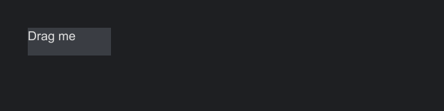

# Events

Everything a component does reaches your code as an event: input such as clicks and keys, a control's changes such as an edit or a close, and even drawing and sizing. There is one way to listen to all of them, `onEvent`. This page covers registering handlers, the two kinds of event, the order things run in, cancellation and bubbling, and how input becomes events. For comparing state before and after an event, see [Event snapshots](snapshots.md).

## Registering a handler

```java
component.onEvent(EventTypes.CLICK, event -> { ... });                         // priority 0
component.onEvent(EventTypes.CLICK, -100, event -> { ... });                   // runs before priority 0
Subscription drag = component.subscribe(EventTypes.DRAG, 0, event -> { ... }); // removable later
```

Event types are typed keys. `EventTypes.CLICK` is an `EventType<PointerButtonEvent>`, so the handler receives a `PointerButtonEvent` without a cast. Input types are the constants in `EventTypes`. Each control declares its own as constants on its interface, such as `Button.PRESS` and `TextBox.EDITED`, and every component has `Component.PAINT`, `Component.PAINTED` and `Component.MEASURED`. Always use the constants, because types are compared by identity.

`onEvent` returns the component, so registration chains with the setters:

```java
--8<-- "events/EventExamples.java:chain"
```

### Priority

On one component, handlers for a type run in ascending priority, and handlers with the same priority run in the order they were registered. A handler registered without a priority has priority 0, and the highest number runs last. Use a negative number to see an event before other handlers, for example to veto first, and a positive one to see what everyone before you decided, for example the final value of a request. A handler may register or remove handlers while it runs; the change applies from the next event.

## Pre and Post

Events come in two kinds.

| Kind | What it says | Can cancel | Fires for | Examples |
|---|---|---|---|---|
| Pre | "About to do this" | Yes, and requests with a value can be rewritten with `setValue` | Input, and the user's actions on a control | `KEY`, `CLICK`, `Button.PRESS`, `TextBox.EDIT`, `Window.CLOSE`, `Component.PAINT` |
| Post | "This happened" | No | Every change, whether the user or code made it | `Button.PRESSED`, `TextBox.EDITED`, `Window.CLOSED`, `Component.PAINTED` |

To stop or change something, handle its Pre event. To react to it, handle its Post event.

```java
--8<-- "events/EventExamples.java:veto"
```

```java
--8<-- "events/EventExamples.java:rewrite"
```

```java
--8<-- "events/EventExamples.java:react"
```

Changes made from code, through setters such as `setText` and methods such as `select` or `close`, fire no Pre event: code does not need permission. They still fire Post events, so a label or a binding hears about every change.

## What runs, in what order

For an input event, at every component the event reaches:

1. The component's handlers, in priority order.
2. The component's default behavior, such as a button pressing or a text box inserting a character, unless the event has been canceled.

A bubbling event then moves to the parent and repeats, up to the screen's root, unless something stopped it. A direct event stays at its target.

A control's request is different. The control fires it through its whole path first, so any handler on the way can refuse it, and acts afterwards with the final value, unless the request was canceled. If it acts, it then fires the matching Post event.

### Handling a whole form

Control events bubble, so one handler on a panel hears the controls inside it:

```java
--8<-- "events/EventExamples.java:form"
```

The events of a control's private parts stop at that control. A table is built from an inner list, but a handler on your form never sees that list's `ListView.SELECTED`; it sees the table's own `TableView.SELECTED`.

## Canceling and stopping

| Call | On | Effect |
|---|---|---|
| `cancel()` | Pre events | For input, skips the default behavior of the current component and of every ancestor the event still reaches. For a request, the control does not make the change. Handlers keep running, and the event keeps bubbling. |
| `stopPropagation()` | All events | The event goes no further up. The current component's remaining handlers and its default behavior still run. |
| `consume()` | Pre events | Both: "handled here". |

`isCancelled()`, `isPropagationStopped()` and `isHandled()` (either one) report the state. Pre events implement `Cancelable`; Post events have no `cancel()`, because what they report already happened.

When an input event finishes, the host reports it to the adapter as consumed if it was canceled or stopped, and the adapter keeps that input from the engine. A handler that acts on input should call `consume()`, so ancestors and the engine do not act on it too.

!!! warning "Built-in controls consume the input they act on"
    A button consumes the clicks and keys that press it, and a text box consumes the keys and characters it edits with. Consuming stops propagation, so that input never reaches the control's ancestors, and a handler on a panel does not see clicks on the buttons inside it. To hear about the buttons, handle `Button.PRESSED` on the panel; control events still bubble.

## Target and current

`target()` is the component the event was fired at. It is fixed for the whole delivery. `current()` is the component whose handlers or default behavior are running now. It starts equal to the target and moves to each ancestor as the event bubbles. Control events also have `control()`, the control that fired them, typed as that control.

`PointerEvent.localX()` and `localY()` are relative to the current component, so they change as the event bubbles. `x()` and `y()` are in host coordinates and do not change.

### Handling input on a container

One handler on a container can serve all of its children, because input from children bubbles up to it. This works for children that do not consume the event, such as labels:

```java
--8<-- "events/EventExamples.java:delegate"
```

The `target() != palette` check skips clicks on the panel's own padding, where the panel itself is the target.

## Event objects are short-lived

An event object is valid only while it is being delivered. Do not keep it to read later: Strata reuses paint and measure events every frame, and `current()` changes as an event bubbles. To keep the state a component had when the event fired, take a [snapshot](snapshots.md), which stays valid.

## Removing handlers

`onEvent` handlers stay as long as their component. For one that must go earlier, such as a handler that follows a drag, register it with `subscribe`, which returns a `Subscription`:

```java
--8<-- "events/EventExamples.java:remove"
```

A `Subscription` is `AutoCloseable`, so it also works in try-with-resources. Closing it twice does nothing.

Removing a component from its tree does not remove its handlers. That rarely matters, because a closed screen's tree is dropped along with them. It matters if you keep a component and reuse it.

## Exceptions

A handler that throws is not caught by Strata. The exception propagates out of the input call that caused the event, into the adapter and the engine. Catch your own errors in handlers.

## Clicks

A press, a release and a click are three events:

1. `POINTER_PRESS` fires at the deepest component under the pointer. Just before it fires, focus moves to that component or its nearest focusable ancestor, or is cleared if there is none.
2. `POINTER_RELEASE` fires at the component the press started on, wherever the pointer is now.
3. `CLICK` fires after the release, at the same component, if the pointer is still over it, the component is enabled, and no drag happened in between.

Each mouse button is tracked separately, so a right-button press during a left-button drag is its own press.

```java
--8<-- "events/EventExamples.java:buttons"
```

### Click counting

`clicks()` says where a press falls in a run of quick presses: 1 for a single click, 2 for a double, 3 for a triple, and then it starts again at 1. A press continues the run when it hits the same component with the same button within 500 ms and within 4 units on each axis of the previous press. A release and its click carry the count of their press.

Strata delivers every press immediately with its count. It never holds a single click back to wait and see whether a double follows, so a double click produces a click with `clicks() == 1` and then one with `clicks() == 2`. React to the count you care about.

## Drags

A press becomes a drag once the pointer moves more than 4 units from where the button went down, measured on either axis.

| Event | When | Positions |
|---|---|---|
| `DRAG_START` | The pointer first passes the threshold | Those of the original press. Deltas are zero. |
| `DRAG` | Every move after that, wherever the pointer is | The current position, with the movement since the previous drag event in `deltaX()` and `deltaY()` |
| `DRAG_END` | The button comes up | The release position. It replaces the `CLICK` that release would otherwise cause. |

Drag events go to the component the press started on, even when the pointer leaves it. `startX()` and `startY()` give the press position, and `clicks()` the press's click count, so a drag after a double click can select by word as text boxes do.



```java
--8<-- "events/EventExamples.java:drag"
```

If the pointer leaves the host during a drag, the press stays tracked, and the drag continues when the pointer comes back.

## Hover

Only the deepest component under the pointer is hovered. Hit testing respects clipping, visibility and enabled state: the pointer cannot hit a hidden or disabled component, or the part of a child cut off by a clipping parent.

| Event | Bubbles | When |
|---|---|---|
| `POINTER_ENTER` | no | The component became the deepest one under the pointer |
| `POINTER_EXIT` | no | It stopped being the deepest one, or the pointer left the host |
| `POINTER_MOVE` | yes | The pointer moved over it. Fired after any enter or exit for the same movement. |

Enter and exit do not bubble, so moving from a panel onto a button inside it gives the panel an exit and the button an enter. When layout moves a component under a still pointer, the enter and exit fire on the next pointer input, not at the moment of the layout.

## Scrolling

`SCROLL` fires at the component under the pointer and bubbles, so an outer container receives scrolls its children do not consume.

| Value | Meaning |
|---|---|
| `scrollY()` | Positive when the wheel turns away from the user, which scrolls toward the top of the content |
| `scrollX()` | Positive toward the left, the start of a row |
| `kind()` | `WHEEL` for a notched wheel (1 per notch), `PRECISE` for trackpads and smooth wheels, which report fractions |

Engines differ in how horizontal scrolling arrives; see [Platform differences](../platforms/differences.md#scrolling).

## Keys and characters

`KEY` carries a physical key (`key()`), an action (`PRESS`, `REPEAT` or `RELEASE`) and the held modifiers. It fires at the focused component, or at the screen's root when nothing has focus, and bubbles. If nothing consumes a Tab press, focus moves to the next tabbable component.

`CHAR` carries a typed character as a code point, after the keyboard layout and any input method. It fires only at the focused component and is dropped when nothing has focus. It bubbles.

A key handler on the root sees every key that nothing focused consumed, which makes it the place for screen-wide shortcuts:

```java
--8<-- "events/EventExamples.java:shortcut"
```

[Input and focus](input-focus.md) covers keys, modifiers, shortcut matching and key repeat in detail.

## Focus events

`FOCUS_LOST` and `FOCUS_GAINED` are direct. When focus moves from one component to another, the old one gets `FOCUS_LOST` first, then the new one gets `FOCUS_GAINED`, and both fire after the focus has already changed. `other()` is the component on the other side of the move, or empty when focus came from or went to nothing.

## Drawing and sizing

Drawing and sizing are events too, so you can change how any component looks without writing a new one.

| Type | Kind | When |
|---|---|---|
| `Component.PAINT` | Pre | Before the component draws its background. Canceling it skips the component's own drawing; its children still draw. |
| `Component.PAINTED` | Post | After the component and its children have drawn, so what a handler draws lands on top |
| `Component.MEASURED` | Post | After the component measured its content. `setWidth` and `setHeight` change the size it asks for. |

```java
--8<-- "events/EventExamples.java:paint"
```

```java
--8<-- "events/EventExamples.java:measure"
```

None of the three bubble, and none take snapshots. A component fires them only when it has a handler for them, and reuses one event object every frame, so a component you do not decorate pays nothing and one you do allocates nothing for the event. Keep paint handlers free of allocation where you can, as in a custom component's `paint`.

## Your own events

A control you write declares its events the way the built-ins do, as constants made with `EventType.request`, `EventType.valueRequest`, `EventType.report` and `EventType.valueReport`, and fires them with `CustomComponent`'s `request` and `report` methods. [Extending Strata](extending.md#events-for-your-own-control) shows a complete example.

## All event types

| Type | Event interface | Bubbles | Fired at |
|---|---|---|---|
| `POINTER_ENTER` | `PointerEvent` | no | The newly hovered component |
| `POINTER_EXIT` | `PointerEvent` | no | The previously hovered component |
| `POINTER_MOVE` | `PointerEvent` | yes | The hovered component |
| `POINTER_PRESS` | `PointerButtonEvent` | yes | The component under the pointer |
| `POINTER_RELEASE` | `PointerButtonEvent` | yes | The component the press started on |
| `CLICK` | `PointerButtonEvent` | yes | The same, if still under the pointer and enabled, with no drag |
| `DRAG_START`, `DRAG`, `DRAG_END` | `DragEvent` | yes | The component the press started on |
| `SCROLL` | `ScrollEvent` | yes | The component under the pointer |
| `KEY` | `KeyEvent` | yes | The focused component, or the root |
| `CHAR` | `CharEvent` | yes | The focused component only |
| `FOCUS_GAINED`, `FOCUS_LOST` | `FocusEvent` | no | The component gaining or losing focus |

The [event type reference](../reference/event-types.md) adds each type's default behavior in the built-in controls. Each control's own events are listed with the control in [Controls](controls.md).
