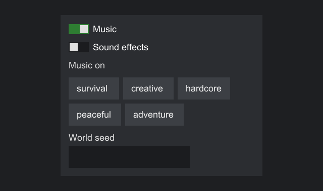

# Extending Strata

There are three ways to extend Strata. Pick the lightest one that does the job.

| Way | Use it to | Cost |
|---|---|---|
| [Decorate a built-in](#decorate-a-built-in-with-a-behavior) | Add drawing, filter input or change the size of a label, button or text box | One anonymous class |
| [Compose](#compose-built-ins) | Package several components as one reusable piece | A plain class |
| [Write a new component](#write-a-new-component) or [layout](#write-a-new-layout) | Make something that does not exist yet | A subclass of `CustomComponent` or `CustomContainer` |

Strata's own widgets and panels are written the third way, on the same public base classes, so you have everything they have.



## Decorate a built-in with a behavior

Pass a behavior to the factory: `factory.button(text, ButtonBehavior)`, `factory.label(text, LabelBehavior)` or `factory.textBox(TextBoxBehavior)`. Each behavior hook wraps one of the component's own, and receives the component plus a `next` handle that runs the component's own behavior, much like calling `super`:

- Leave a hook alone and the component behaves as usual.
- Call `next.proceed()` and add to it to extend the behavior.
- Do not call `next` to replace the behavior.

Draw on top of a button:

```java
--8<-- "extending/ExtendingExamples.java:paint"
```

Filter what a text box accepts:

```java
--8<-- "extending/ExtendingExamples.java:filter"
```

Change how big a label wants to be:

```java
--8<-- "extending/ExtendingExamples.java:measure"
```

The hooks are `measure`, `paint`, and one per event type: `onPointerEnter`, `onPointerExit`, `onPointerMove`, `onPointerPress`, `onPointerRelease`, `onClick`, `onDragStart`, `onDrag`, `onDragEnd`, `onScroll`, `onKey`, `onChar`, `onFocusGained` and `onFocusLost`.

Rules for behaviors:

- Call `next` at most once per hook call, and only during that call.
- Event hooks run in the default-behavior step, between the `BEFORE` and `AFTER` handlers, so a canceled event skips them too.
- `measure` and `paint` follow the same rules as in a custom component: no layout changes, and no allocation in `paint` if you can avoid it.
- One behavior object may be shared by several components. Keep per-component state off it, or key it by the component argument. The badge example above keeps its state in a local array because it makes one behavior per button.

Behaviors versus event handlers: a `BEFORE` handler that cancels also skips the default behavior, but a behavior can run the default behavior conditionally, or run code around it, and it can change measuring and painting, which handlers cannot.

## Compose built-ins

When the piece is just existing components arranged a certain way, you need no Strata base class at all. Build the parts in a container and hand out the container:

```java
--8<-- "extending/ExtendingExamples.java:compose"
```

The class is not a `Component`, so you add `field.component()` rather than `field`. To make a composite that is a component itself, so it can be passed anywhere a component can, extend `CustomContainer` and add the parts as its children.

## Write a new component

Subclass `CustomComponent<T>`. To let other code see your component as a type of its own, declare an interface that extends `Component<YourInterface>` and implement it. This example builds a small switch; Strata's own [`ToggleSwitch`](widgets.md#toggleswitch) is written the same way in core.

```java
--8<-- "extending/ToggleSwitch.java:interface"
```

```java
--8<-- "extending/ToggleSwitchImpl.java:impl"
```

Using it looks like using a built-in:

```java
--8<-- "extending/ExtendingExamples.java:use"
```

Its required keys must be in the theme:

```java
--8<-- "extending/ExtendingExamples.java:theme"
```

### The hooks

| Hook | Called | Default |
|---|---|---|
| `measure(context, availableWidth, availableHeight)` | During layout. Return the content's natural size. Required. | |
| `paint(painter, bounds)` | Every frame, after the background and before a container's children | Draws nothing |
| `requiredStyleKeys()` | When the component joins a host, and when the theme changes | None |
| `onApplyTheme(theme)` | On attach and whenever the theme changes, before the next layout | Nothing |
| `acceptsTextInput()` | When it gains focus | false |
| `snapshotState()` | When an event with [snapshots](snapshots.md#your-own-components) captures it | null |
| `onClick(event)` and the other `on...` hooks | The default-behavior step of each event | Nothing |
| `onOtherEvent(type, event)` | For event types not in `EventTypes` | Nothing |

### Rules

- Pass the factory of the host that will show the component. A component cannot move between hosts.
- `measure` must be pure layout. Compute and return a size, and cache what `paint` needs. Strata has already removed the margin and applied the maximum size; it applies the minimum and any fixed size to what you return. The available size may be infinite, and a negative result counts as zero. Do not change other components or call `invalidateLayout()` from it.
- `paint` draws inside the bounds it is given and must not change layout state. It runs every frame, so avoid allocating there. The painter is valid only during the call.
- Call `invalidateLayout()` whenever something `measure` reads changes. Changes that only affect drawing need nothing: the next frame draws them.
- Read time, the clipboard and text sizes through `environment()`, never from `System.currentTimeMillis()` or AWT, so the component works on every engine and in tests.
- Event hooks run only while the component is attached, and a hidden or disabled component gets no new pointer or keyboard input.
- Consume the events you act on, so ancestors and the engine do not act on them too.
- Everything runs on the UI thread. Exceptions thrown from hooks propagate to the engine's call into Strata.

Every `Component` method is `final` on `CustomComponent` and delegates to Strata's half of the component, its peer, so your component takes part in layout, focus, hit testing and events like any other. Return `this.self()` from your own setters to keep chaining typed.

### Painting

The `Painter` a component draws with:

| Method | Draws |
|---|---|
| `fill(rect, argb)` | A solid rectangle |
| `fillGradient(rect, top, bottom)` | A vertical gradient |
| `sprite(id, rect, tint)` | An image stretched over the rectangle |
| `nineSlice(id, rect, border, tint)` | A nine-slice image |
| `text(span, x, y)` | One line of text, top-left at the point |
| `clipped(rect, draw)` | Runs `draw` with drawing limited to the rectangle, intersected with any clip in place |
| `translated(dx, dy, draw)` | Runs `draw` with every coordinate shifted |

Coordinates are host coordinates in UI units. Later calls draw over earlier ones. Clipping and translation take a callback, so the engine's state is always restored, even if the callback throws. Any `Paint` from a theme draws itself with `paint.paint(painter, rect)`.

### The environment

`environment()` gives a component what it may ask of the engine outside layout:

| Method | Returns |
|---|---|
| `text()` | The engine's text metrics, the same ones layout uses |
| `millis()` | The host's clock in milliseconds. Only differences mean anything. |
| `clipboardText()` | The clipboard text, or empty |
| `setClipboardText(text)` | Puts text on the clipboard. Engines without one ignore it. |

It works before the component is attached.

## Write a new layout

Subclass `CustomContainer<T>`. It is a `CustomComponent` that also measures and places children. This flow layout wraps its children into rows like words in a paragraph:

```java
--8<-- "extending/WrapPanel.java:wrap"
```

Everything required of a custom component applies, plus:

- In `measure`, measure every child, hidden or not, with `context.measure(child, width, height)`. It returns the child's desired size plus its margin, or zero for a hidden child. A child you do not measure keeps a stale size.
- In `arrange`, give every child a slot with `context.arrange(child, slot)`, hidden children included. The slot includes the child's margin; the child shrinks it by the margin and aligns itself inside. `context.outerSize(child)` returns what the child asked for in the last measure. A child you do not arrange keeps stale bounds.
- Handle the padding yourself: take it off the space you offer children, add it to the size you return, and place children inside `contentBox()`.
- Keep per-child data, such as a grid cell, in your own map, and drop it in `onChildRemoved`.
- Leave drawing the children to Strata. Your `paint` draws under them, and they are clipped to your bounds while `clipsChildren()` is true.

## Things you cannot do

- Implement `Component`, `Container` or a widget interface directly. Strata rejects such classes.
- Subclass the built-in widgets. Their implementations are hidden in `core`. Decorate them with a behavior, or write your own.
- Fire your own events. See [Custom event types](events.md#custom-event-types).
- Draw arbitrary geometry, such as lines or textured triangles. The painter offers rectangles, gradients, sprites and text only, because every engine can draw those. See [Status and limitations](../help/status.md).
- Use `ComponentFactory.createPeer`, `createContainerPeer`, `CustomComponent.peer()` or anything in `api.extension.peer`. They are plumbing between the base classes and core.
