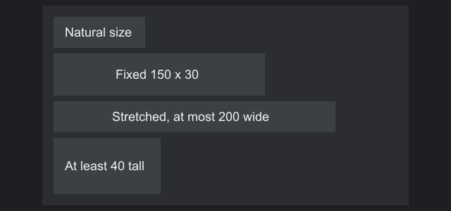
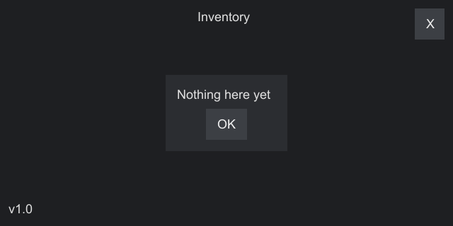
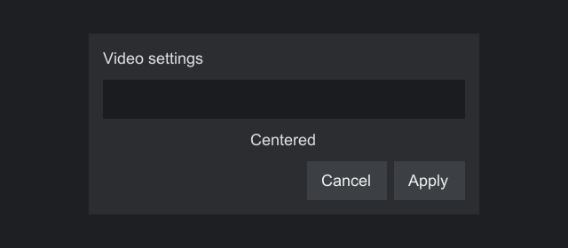
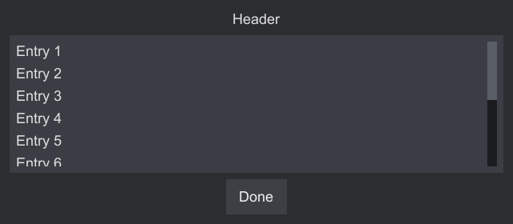
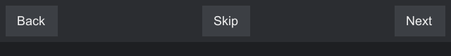
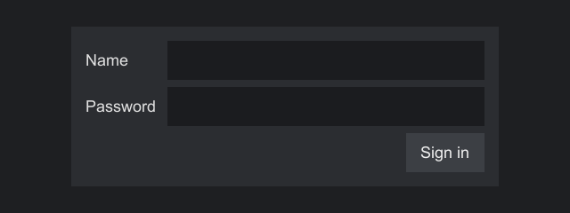
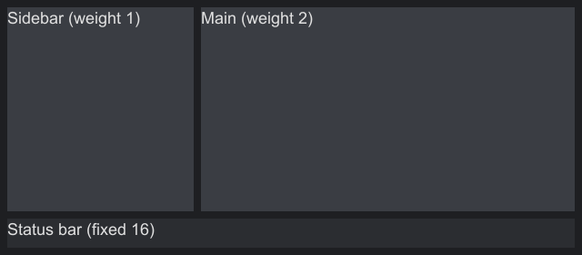
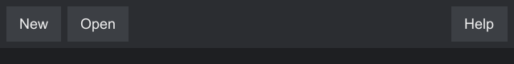
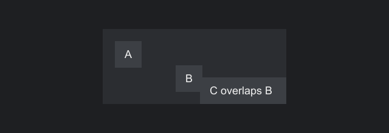
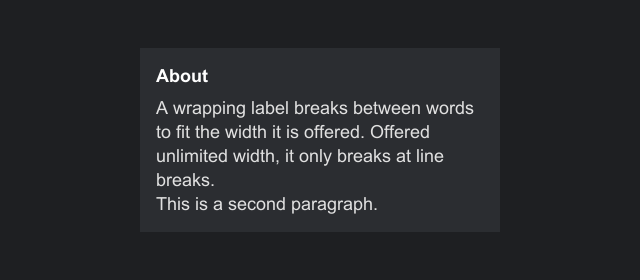

# Layout

Strata lays out a tree in two passes, the way WPF and Wintergreen do. This page explains the passes, every input a component has, each of the containers, and the spacer.

## The two passes

Layout runs before a frame is drawn, and only after something changed.

Measure
:   Each container offers each child some available space, possibly infinite, and asks how big it wants to be. The child answers with its desired size. Containers measure their children first, then decide their own desired size from them.

Arrange
:   Each container gives each child a slot: a rectangle, margin included. The child shrinks the slot by its margin and places itself inside by its alignment and size limits. The resulting rectangle is its bounds.

The screen's root gets the whole host as its slot.

A change that affects size, such as new label text, a new child or a different margin, marks the component and its ancestors for layout, and the whole tree is laid out again before the next frame. Nothing is measured every frame, and a change that only affects drawing, such as a background, causes no layout at all.

## Inputs every component has

| Input | Default | Meaning |
|---|---|---|
| Margin | `Insets.NONE` | Space kept clear around the component, outside its bounds |
| Minimum size | 0 by 0 | The smallest size it may take |
| Maximum size | infinite | The largest size it may take. It also limits the space offered when measuring, so text wraps within it. |
| Fixed width and height | unset (`NaN`) | Replaces the measured size and overrides `STRETCH` |
| Horizontal alignment | `LEFT` | Where it sits across its slot's width |
| Vertical alignment | `TOP` | Where it sits across its slot's height |
| Offset | 0, 0 | Moves it after layout places it; see [Offset](#offset) |

Containers add padding (`Insets.NONE` by default): space inside their edges that children stay out of.

Every component also has a border (`setBorder(Border.of(argb, width))`, a width per side with `new Border(argb, insets)`). It draws along the inside of the bounds, over the background, and takes no space in layout, so give a container padding at least as wide as its border.

### Offset

`setOffset(dx, dy)` moves a component, and everything inside it, from where its parent's layout puts it. Siblings and the parent's size do not change, and the move needs no new measure. Use it for small nudges and for dragging; a [window](controls.md#window) moves by its offset when its title bar is dragged.

### How a component's size is decided

For each axis:

1. If a fixed size is set, use it.
2. Otherwise, if the alignment is `STRETCH`, use the slot's size minus the margin.
3. Otherwise, use the desired size.
4. Then clamp to the minimum and maximum.

The minimum and maximum always win, even over a fixed size.

With any alignment other than `STRETCH`, a component keeps its size even if the slot is smaller and overflows it. If an ancestor clips its children, which containers do by default, the overflow is cut off.

### Alignment

| Horizontal | Vertical | Places the component |
|---|---|---|
| `LEFT` | `TOP` | Against the slot's left or top edge, after the margin |
| `CENTER` | `MIDDLE` | Centered in the slot |
| `RIGHT` | `BOTTOM` | Against the right or bottom edge, before the margin |
| `STRETCH` | `STRETCH` | Filling the slot minus the margin, unless a fixed size is set |

`setAlignment(horizontal, vertical)` sets both. `setAnchor(Anchor)` sets both at once by name:

| Anchor | Horizontal, vertical |
|---|---|
| `TOP_LEFT`, `TOP_CENTER`, `TOP_RIGHT` | `LEFT`/`CENTER`/`RIGHT`, `TOP` |
| `MIDDLE_LEFT`, `CENTER`, `MIDDLE_RIGHT` | `LEFT`/`CENTER`/`RIGHT`, `MIDDLE` |
| `BOTTOM_LEFT`, `BOTTOM_CENTER`, `BOTTOM_RIGHT` | `LEFT`/`CENTER`/`RIGHT`, `BOTTOM` |
| `FILL` | `STRETCH`, `STRETCH` |

Alignment is a request to the parent. Each container decides how big a slot to give, and some ignore alignment along one axis. The container sections below say which.

### Margin and padding


```java
--8<-- "layout/LayoutExamples.java:spacing"
```

A container's background covers its padding, but a child's margin belongs to the child and is never painted by it. Insets can be negative: a negative margin lets a component overlap its neighbors, and layout clamps any size that would go below zero.

`Insets.of(all)` sets every side, `Insets.of(horizontal, vertical)` sets left and right to one value and top and bottom to another, and the record constructor `new Insets(left, top, right, bottom)` sets each side.

### Size limits in practice



```java
--8<-- "layout/LayoutExamples.java:sizes"
```

To go back to the measured size after fixing one, pass `Float.NaN` to `setWidth` or `setHeight`.

## AnchorPanel

Every child gets the whole content area (the bounds minus padding) as its slot, so children overlap and place themselves by their own anchor. Use it to pin things to edges, corners and the center of the same area. Its desired size is the largest child plus margin, plus the padding.



```java
--8<-- "layout/LayoutExamples.java:anchor"
```

The root of most screens is an anchor panel with `Anchor.FILL`.

## StackPanel

Children follow one another in a column (`Orientation.VERTICAL`, the default) or a row (`Orientation.HORIZONTAL`), with `setSpacing` units between neighbors and none before the first or after the last.

Along the orientation, each child gets exactly the space it asks for, so alignment along that axis has no effect, unless the child has a weight (below). Across it, each child gets the full content size and aligns itself: in a column, `STRETCH` makes a child as wide as the column, and `CENTER` centers it. Hidden children take no space and no gap.



```java
--8<-- "layout/LayoutExamples.java:stack"
```

### Weights

`add(child, weight)`, or `setWeight(child, weight)` for a child already added, gives a child a share of the room the other children and the gaps leave. Weight 2 gets twice the space of weight 1, and 0 takes the weight away again. A weighted child is placed in its share by its own alignment, so give it `STRETCH` along the orientation to fill it. Its share never goes below zero, and its own desired size does not count once the panel has a size, so a weighted child shrinks first when space runs out. Measured without a limit along its orientation, inside a scroll panel for example, the panel asks for enough room to give each weighted child its desired size while keeping the proportions. `weight(child)` reads a weight back, and removing a child forgets its weight.

This covers a frame with a header and a footer at their own height and a body that takes the rest:



```java
--8<-- "layout/LayoutExamples.java:frame"
```

### Spreading

`setSpread(true)` spreads the children across the content box with equal gaps, the first at the start and the last at the end. The panel still asks only for its children and its spacing, so give it room: stretch it or give it a fixed size. The spacing becomes the smallest gap, a single child stays at the start, and spreading does nothing while a visible child has a weight, since that child takes the extra room.



```java
--8<-- "layout/LayoutExamples.java:spread"
```

## GridPanel

Children sit in the cells of rows and columns. Each row and column has a `GridLength`:

| Length | Size |
|---|---|
| `GridLength.auto()` | As big as the largest child that sits only in it |
| `GridLength.fixed(size)` | Exactly `size` units, whatever its children need |
| `GridLength.weighted(weight)` | A share of the space left after the fixed and auto tracks. Weight 2 gets twice the space of weight 1. |

Fixed and auto tracks are sized first. Whatever width or height remains is shared among weighted tracks in proportion to their weights. When the grid itself is measured without a size limit, weighted tracks take the smallest size that fits their children while keeping their proportions.

```java
--8<-- "layout/LayoutExamples.java:grid"
```



- `add(child, row, column)` puts a child in one cell. `add(child, row, column, rowSpan, columnSpan)` lets it cover several. A spanning child's slot includes the spacing between the cells it covers.
- A child added with plain `add(child)` sits in row 0, column 0.
- Several children may share a cell. They overlap, like in an anchor panel.
- A child aligns itself within its cell. `STRETCH` fills the cell.
- Children spanning several auto tracks grow those tracks if they would not fit otherwise.
- A grid with no rows or columns defined acts as one auto cell.
- A cell outside the defined rows or columns is moved to the last row or column, and spans are cut to fit. A negative row or column, or a span below 1, throws `IllegalArgumentException`.
- `setSpacing(columnGap, rowGap)` puts gaps between tracks, never around the edge. Use padding for that.
- `columns(...)` and `rows(...)` replace the definitions; `addColumn` and `addRow` append one. `cellOf(child)` tells you where a child sits.

Weighted tracks make proportional layouts:



```java
--8<-- "layout/LayoutExamples.java:weighted"
```

## Spacer

`factory.spacer()` makes an empty component that only takes room: it draws nothing of its own, takes no input and asks for no size. It has `Anchor.FILL`, so it fills whatever slot it gets. Give it a weight in a stack panel to take the room that is left, or a fixed size with `factory.spacer(width, height)` to keep a set gap.



```java
--8<-- "layout/LayoutExamples.java:spacer"
```

## AbsolutePanel

Each child sits at a fixed position measured from the top-left corner of the content area. Its slot is exactly its desired size plus margin at that position, so alignment has no effect. Children may overlap; later ones are drawn on top. The panel's desired size is just big enough to cover every child.



```java
--8<-- "layout/LayoutExamples.java:absolute"
```

`add(child)` places a child at (0, 0). `move(child, x, y)` moves one later and does nothing if it is not a child. There is no getter for a child's position, so keep your own if you need it, as the [drag example](events.md#drags) does.

Use it for free placement, such as a board of draggable pieces. For forms and menus, the other containers adapt to text and screen size, so prefer them.

## ScrollPanel

Shows part of content larger than itself. Children are laid out as in an `AnchorPanel`, each given the whole scrolled area; most panels hold one `StackPanel` or `GridPanel`.

```java
StackPanel rows = factory.stackPanel().setSpacing(1);
rows.setAlignment(HorizontalAlignment.STRETCH, VerticalAlignment.TOP);
ScrollPanel scroll = factory.scrollPanel().add(rows);
scroll.setHeight(200);
```

Each axis has a policy: `NEVER` (the axis does not scroll, and children get the viewport's size on it, so text wraps), `AUTO` (it scrolls, and its bar shows only when needed) or `ALWAYS`. The default is vertical `AUTO`, horizontal `NEVER`. The panel asks for its content's size, but no more than it is offered on a scrolling axis, so give it a height or stretch it in a parent with room.

| Input | Scrolls |
|---|---|
| Wheel | 10 units a notch, set with `setScrollRate`. A scroll past the end is not consumed, so it reaches an outer panel. |
| The bar | Drag the thumb, or press the track to page |
| Up, Down, Page Up, Page Down, Home, End | When no focused descendant used them |
| Focus | A descendant that gains focus is scrolled into view |

`setScroll(x, y)`, `scrollBy` and `scrollToVisible(component)` work from code, and `ScrollPanel.SCROLLED` reports every change of offset. Scrolling moves the children's real bounds without measuring them again, so pointer positions and `bounds()` stay in host coordinates inside a scroll panel. Children are clipped to the viewport, the bounds less the padding and the bar's gutter. For long lists of similar rows, use a [`ListView`](controls.md#listview), which builds only the rows in view.

## Clipping

Containers clip their children to their own bounds by default. A clipped part of a child is neither drawn nor hit by the pointer, so a child scrolled out of view cannot be clicked, and a child entirely outside the clip is not drawn at all. `setClipChildren(false)` lets children draw outside, for example a focus glow. For something that must hang over everything, such as a menu, use a [popup](overlays.md#popups).

## Recipes

### Center something on the screen

Put it in a root anchor panel with `Anchor.FILL` and give it `Anchor.CENTER`. Give it a fixed width if it holds stretched children, so they have a width to stretch to.

### Filling the remaining space

In a stack panel, give the child that should fill the rest a weight of 1 and stretch it, as the [frame](#weights) does. To push the children after a point to the far end, put a [weighted spacer](#spacer) there. In a grid, use a weighted row or column, which can stay empty for the same effect.

### Wrapping text

A wrapping label needs a width to wrap to: a fixed width, a maximum width, or `STRETCH` inside a parent that has a width. Offered unlimited width, it breaks only at `\n`.



```java
--8<-- "layout/LayoutExamples.java:wrap"
```

### Equal-width buttons

Add them to a stretched row with the same weight each and give each `Anchor.FILL`, or put them in a grid with equal weighted columns, or give each the same fixed width.

## Common problems

| Symptom | Likely cause |
|---|---|
| A component is not visible at all | Its size is zero: a container with no children measures as just its padding. Or it is hidden, or outside a clipping ancestor, or the root is not `FILL` and is smaller than you think. |
| A stretched child is not stretching | Its parent has no width to give. The root must be `FILL`, or a parent between needs a fixed width or `STRETCH`. |
| A child is cut off | It is bigger than its slot and an ancestor clips. Give the ancestor more room, or turn clipping off. |
| Text does not wrap | See [Wrapping text](#wrapping-text). |
| Alignment along a stack's direction does nothing | A stack panel gives each child exactly its size along that axis. Give the child a [weight](#weights), or use a grid. |
| `bounds()` is out of date | Layout runs before the next frame. Read bounds in a later frame or in an event handler. |

See [Troubleshooting](../help/troubleshooting.md) for more.

## Writing your own layout

Extend `CustomContainer`. The [extending guide](extending.md#write-a-new-layout) walks through a flow layout that wraps children into rows.
