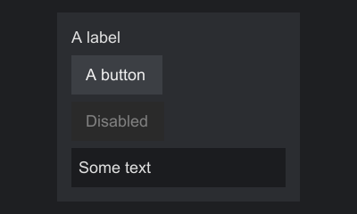
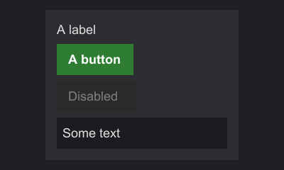
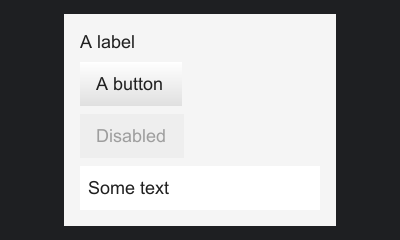

# Themes

A theme decides how components look. It maps style keys, such as `button.hovered`, to paints and text styles. Every component in one host shares the host's theme.

## Built-in themes

| Theme | Where | Look |
|---|---|---|
| `Themes.flat()` | `api` | Dark, solid colors only. Works on any engine without image assets. |
| `MinecraftThemes.vanilla()` | `mc-common` | Vanilla's own widget sprites with their real nine-slice borders, white shadowed text |

Both define every key of every built-in widget.



## Deriving a theme

Themes are immutable. `toBuilder()` starts a builder holding all of a theme's keys, so a variant only lists what changes:

```java
--8<-- "theming/ThemeExamples.java:derive"
```



## A theme from scratch

`Theme.builder(name)` starts empty. The name appears in error messages.

```java
--8<-- "theming/ThemeExamples.java:scratch"
```



Labels and panels have no backgrounds in any theme. Set those per component with `setBackground`.

## Required and optional keys

Each widget lists the keys it reads as `STYLE_*` constants on its interface. Some are required, and the rest are optional with a documented fallback. The [theme key reference](../reference/theme-keys.md) lists them all.

A host checks the theme before it shows anything. When it opens a screen, it collects the required keys of every component in the tree, and if the theme lacks any of them it throws a `ThemeException` that lists every missing key at once, so one run shows everything to add. The same check runs when a component is added to a tree that is already on screen, and when the host's theme changes.

```java
--8<-- "theming/ThemeExamples.java:missing"
```

Your own components declare required keys through `requiredStyleKeys()`. Remember to add them to the theme you use, as the [switch example](extending.md#write-a-new-component) does.

A key may have a paint, a text style, or both; `has(key)` is true for either. Look keys up with `paint(key)` and `textStyle(key)`, which return `Optional`, or with `paintOr` and `textStyleOr`, which take a fallback.

## Paints

A `Paint` fills a rectangle. There are four kinds:

| Factory | Record | Draws |
|---|---|---|
| `Paint.solid(argb)` | `Paint.Solid` | One color |
| `Paint.gradient(top, bottom)` | `Paint.Gradient` | A vertical gradient |
| `Paint.sprite(id)` | `Paint.Sprite` | An image stretched over the rectangle |
| `Paint.nineSlice(id, border)` | `Paint.NineSlice` | An image cut into a 3 by 3 grid |

`Paint.NONE` draws nothing; it is the default background. The sprite factories make untinted paints. To tint, use the record constructor with an ARGB tint, which is multiplied with the image's pixels: `new Paint.NineSlice(id, border, 0xFFC0C0C0)` darkens it slightly. Opaque white leaves an image unchanged.

`paint.paint(painter, rect)` draws any paint, so custom components need not care which kind they hold.

### Colors

Colors are ARGB ints, `0xAARRGGBB`, as in Minecraft. The alpha byte comes first: `0xFF000000` is opaque black, and `0x80FFFFFF` is half-transparent white.

A color with alpha 0 draws nothing, so be careful with `0xRRGGBB` literals: `0xFF0000` has alpha 0 and is invisible. Write `0xFFFF0000` for opaque red.

### Sprites

A `SpriteId` names an image as `namespace:path`:

```java
--8<-- "theming/ThemeExamples.java:sprites"
```

Each adapter decides where the image comes from. The Swing adapter reads it from the classpath, by default at:

```text
assets/<namespace>/sprites/<path>.png
```

A `SpriteResolver` given to `SwingSprites` maps ids to any other layout. A missing image draws as magenta.

`SpriteId.parse("examplemod:button")` parses the text form. A missing namespace is an error, so a sprite never lands in another namespace by accident.

### Nine-slices

A nine-slice keeps its corners at their size, stretches its edges along one axis and its center both ways, so one small image can frame a rectangle of any size. `border` gives the width of each fixed edge in the image's pixels.

On Minecraft, the slicing comes from the sprite's `.png.mcmeta` file and `border` is ignored. Keep the two in agreement so both engines draw the same:

```json
{
  "gui": {
    "scaling": {
      "type": "nine_slice",
      "width": 200,
      "height": 20,
      "border": 4
    }
  }
}
```

This is vanilla's format, checked against the 26.3 sources. `width` and `height` are the size, in GUI pixels, that the image represents. `border` is either one number for all four sides or an object with `left`, `top`, `right` and `bottom`, and the left and right borders together must be narrower than `width` (top and bottom likewise against `height`). An optional `"stretch_inner": true` stretches the edges and center instead of tiling them.

Without an `.mcmeta`, Minecraft stretches the image like a plain sprite, so a nine-slice paint with no `.mcmeta` looks the same as a sprite paint there. When a rectangle is smaller than the borders, the Swing adapter shrinks the borders to fit.

## Text styles

A `TextStyle` sets color, bold, italic, underline, strikethrough and a shadow. Themes map text keys to styles; labels can also take one directly. See [Text](text.md).

## Per-component overrides

Backgrounds and label text styles can be set per component, outside the theme:

```java
--8<-- "theming/ThemeExamples.java:local"
```

There is no per-component theme or per-subtree theme. To give one button a different face, decorate it with a behavior that paints something else, or write a component that reads its own keys.

## Changing the theme at run time

The host owns the theme. Adapters can change it with `ScreenHost.setTheme` or `ScreenStack.setTheme`; components then re-read their keys in `onApplyTheme` and a new layout runs. See [Screens](screens.md#changing-the-theme).
