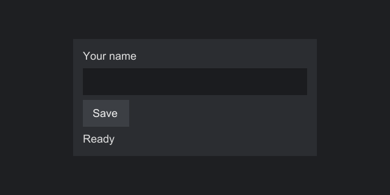

---
hide:
  - navigation
---

# Strata

Strata is a GUI library for Java games that does not depend on any engine. You describe a screen as a tree of components: labels, buttons, text boxes and the panels that lay them out. An adapter then draws that tree and feeds it input on a particular engine. The same screen code runs in a Swing window on your desktop and inside Minecraft 26.3 on NeoForge or Fabric.



```java
--8<-- "quickstart/SettingsScreen.java:screen"
```

## What you get

- Two-pass layout (measure, then arrange) with four containers: `AnchorPanel`, `StackPanel`, `GridPanel` and `AbsolutePanel`.
- Labels with word wrapping, buttons, and a single-line text box with selection, clipboard, word movement and a password mode.
- Click counting, dragging, hover, keyboard focus and tab order, handled the same way on every engine.
- Typed events with a before and an after phase, cancellation that really skips the default behavior, and bubbling to ancestors.
- Lazy event snapshots, so a handler can compare a component's state at the moment an event fired with its state now.
- Themes that map style keys to colors, gradients, sprites and nine-slices. A missing key is reported before anything draws, along with every other missing key.
- Three ways to extend: decorate a built-in widget, compose several, or write your own component or layout on the same base classes the built-ins use.
- A small SPI for engine adapters, with contract tests that hold every adapter to the same rules.

## Where to start

<div class="grid cards" markdown>

- [Installation](getting-started/installation.md): requirements, building from source, and adding Strata to a Swing app or a NeoForge or Fabric mod.
- [Your first screen](getting-started/first-screen.md): a step-by-step walk through the screen above, run in Swing and in Minecraft.
- [Core concepts](getting-started/concepts.md): the handful of ideas everything else builds on.
- [Guides](guides/index.md): layout, widgets, events, snapshots, focus, themes and extending, each in depth.
- [Minecraft](platforms/minecraft.md): what changes inside the game, from GUI pixels to SDL scancodes.
- [FAQ](help/faq.md) and [Troubleshooting](help/troubleshooting.md): short answers to common questions, and fixes for common errors.

</div>

## Project status

Strata is at version 0.1.0 and has not been released. The API will still change, and nothing has been run inside a Minecraft client yet: the Minecraft adapter compiles against the real 26.3 classes and is unit tested, but no screen has been opened in game. [Status and limitations](help/status.md) lists what works, what is untested and what is planned.

Strata is released under the MIT License.
